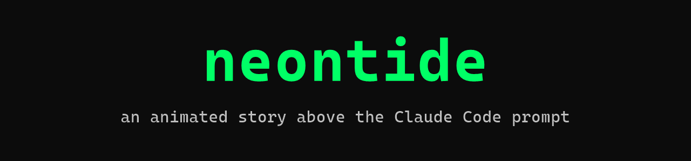
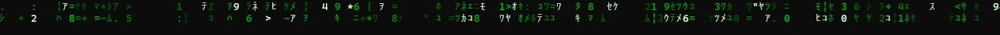
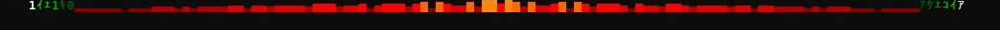
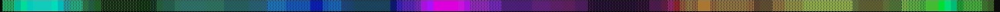
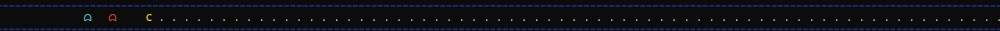
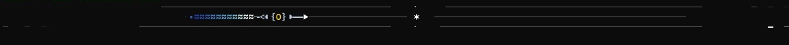
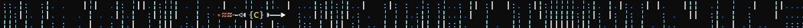
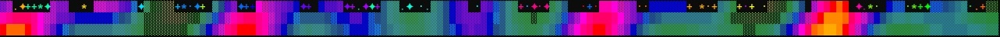

<p align="center"></p>

<!-- demo GIF goes here:  -->

While Claude thinks, a simulation runs in a thin band above your prompt. It builds a little world,
sends one small character on a journey through it, and then breaks: it crashes, reboots as a new
version, and starts again. When Claude stops working, the band hides and the story pauses; when
Claude starts again, it carries on where it left off.

It is a [Claude Code mod](https://code.claude.com/docs/en/plugins/mods). It runs on your machine,
draws only while Claude works, and costs no tokens. It never reads or writes your files, runs
commands, uses the network or calls the model: it only draws, and saves its place in the story.

> **Flashing lights:** the story has lightning flashes, a white flash at the warp jump and glitch
> flicker. If that's a problem for you, `/neontide off` stops it.

## What happens

The simulation boots like an old computer, then plays its chapters in order:

1. **Boot.** A cursor blinks and `SIMULATION v1.0` types out. Each line loads unevenly
   (`> loading signal`, `> generating sky`, `> seeding life`…). The stability check stalls at 87%
   and blinks **WARN**. A burst of matrix rain, and it begins.
2. **Scanner.** A beam sweeps the band, matrix-green, then other colours. It splits in two, the pair
   crosses, and the last beam dives into the middle and races out to both edges.
3. **Equalizer.** The signal comes alive as bars, drifting from fire through cool blue to rainbow.
4. **Aurora.** The simulation makes a sky: shimmering curtains through twelve colours.
5. **Pac-man.** The sky burns out into a row of dots, and out of them comes the first living thing:
   a pac-man, born hungry. He eats through a maze with two ghosts behind him.
6. **The ship.** A ship builds round him, `·∙≈≈╼▐{C}▌━━▶`, and launches. The maze streams away.
7. **Warp.** Faster and faster. The afterburner turns blue with shock diamonds `◆`, then the jump:
   stars stretch into lines and the light blooms white.
8. **Space.** Out of hyperspace into a nebula, constellations drawing themselves, a starfield, a
   comet streaking past underneath, and a planet rising ahead.
9. **The storm.** The ship dives through the clouds into the rain. Drizzle becomes a downpour, then
   a gale with sheet lightning, then forked bolts and thunder that shakes the ship.
10. **The strike.** The last and biggest bolt hits the ship. It explodes, the pac-man tumbles clear,
    and the wreck burns.
11. **The crash.** The fire melts into rainbow plasma, the plasma corrupts into glitch, and the glitch
    crashes: `ERROR : SIMULATION v1.0 FAILED`, `RESTARTING v1.1...`, and the next loop begins.

### Screenshots

| | |
|---|---|
| Boot |  |
| Matrix rain |  |
| Scanner |  |
| Equalizer |  |
| Aurora |  |
| Pac-man |  |
| The ship |  |
| Warp |  |
| The storm |  |
| The crash |  |

One loop takes about **8 minutes of Claude working**. The version number counts your sessions and
loops: `SIMULATION v6.2` is the sixth session's third loop. The whole story, with timings, is in
[SIMULATION.md](SIMULATION.md).

## Install

At the prompt of a Claude Code terminal session:

```
/plugin install neontide --marketplace kumar-w0rkspace/neontide
```

Answer `y` to add the marketplace, then press Enter for the user scope. Or from a shell:

```
claude plugin install neontide --marketplace kumar-w0rkspace/neontide
```

It is on straight away: the next time Claude works, the simulation boots.

It changes none of your settings. Installing adds the usual plugin entry to your user settings, like
any plugin; pick **project** scope instead to keep it to one project.

To get new versions: `/plugin marketplace update neontide`, then update neontide in `/plugin`
(or turn on auto-update for the neontide marketplace there). Then run `/reload-plugins` or start a
new session.

## Use

| Type | Does |
|---|---|
| `/neontide` | Says whether it is on, and which chapter is playing |
| `/neontide off` | Stops it (it stays off in new sessions until you turn it on) |
| `/neontide on` | Starts it again, from the boot screen |

## Uninstall

To pause it, `/neontide off`. To remove it, `/plugin` → **Installed** → neontide → **Uninstall** (or
`claude plugin uninstall neontide@neontide`), then `/plugin marketplace remove neontide` to drop the
marketplace too. It changes no other settings, so nothing else needs undoing.

## What you need

- **Claude Code** with mods (v2.1.287 or newer), in a **terminal**. It does not draw in the desktop
  app or an editor's panel.
- **A font with box-drawing and block characters** (`━ ░ ▒ ▓ █ ▀ ▄ ◆ ✶`). Most modern terminal fonts
  have them: Cascadia Code (Windows Terminal's default), JetBrains Mono, Fira Code, Menlo.
- The matrix rain uses Japanese katakana (`ｦｱｳｴｵｶ`). On Linux, if you see boxes, install a CJK font
  (for example `sudo apt install fonts-noto-cjk`).
- **24-bit colour** for the smooth fades (Windows Terminal, iTerm2, most Linux terminals).
- At least about **60 columns** wide; it looks best from about 100.
- It takes **1 to 3 rows** above the prompt (3 for most chapters), only while Claude works, so the
  prompt shifts a little as chapters change.

## Troubleshooting

- **Looks washed out or messy?** neontide is made for **dark** terminal themes: it draws on your
  terminal's own background, and on a light one its fades run backwards and the white stars vanish.
  Switch to a dark colour scheme (Windows Terminal: Settings, your profile, Appearance).
- **Nothing shows?** It only plays while Claude is working, in a terminal, on Claude Code v2.1.287 or
  newer. Older versions install it but never draw it. Check `/neontide` says it is on.
- **Blocky or wrong colours?** Your terminal needs 24-bit colour. Inside tmux, add
  `set -ga terminal-overrides ",*:Tc"` to `~/.tmux.conf`; over SSH, check the remote `TERM` supports it.
  On a Mac, older versions of Terminal.app lack it; iTerm2, Ghostty or WezTerm work.
- **Several sessions open?** They share one story: a new session carries on from whichever saved last,
  and `/neontide off` applies to new sessions, so restart the other open ones.
- **Install refused?** Some organisations only allow approved plugin marketplaces. Ask your admin.

Found a bug, or have an idea for the story? [Open an issue](https://github.com/kumar-w0rkspace/neontide/issues/new/choose).
Security problems go privately, see [SECURITY.md](SECURITY.md).

## License

Free to use, change and share under the [MIT License](LICENSE). Keep the copyright notice in your copies.
